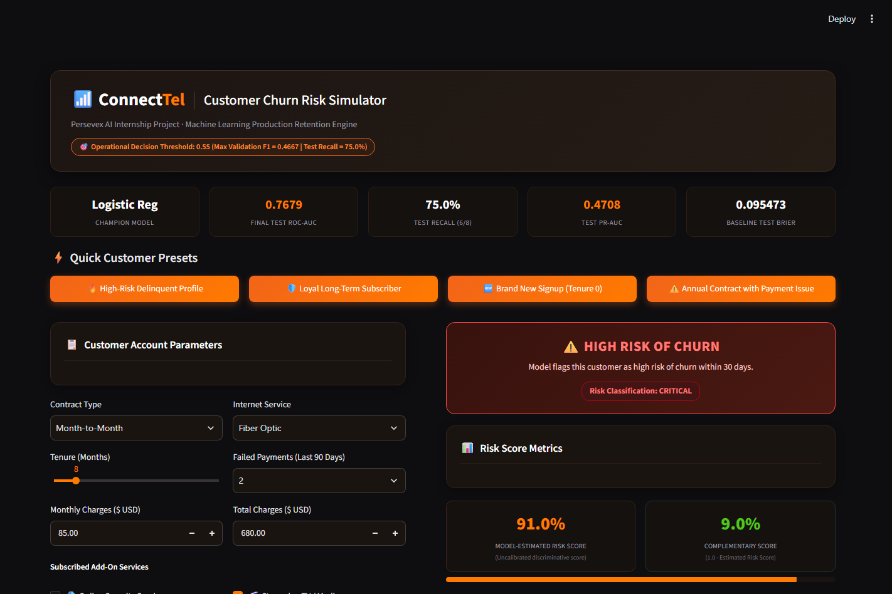
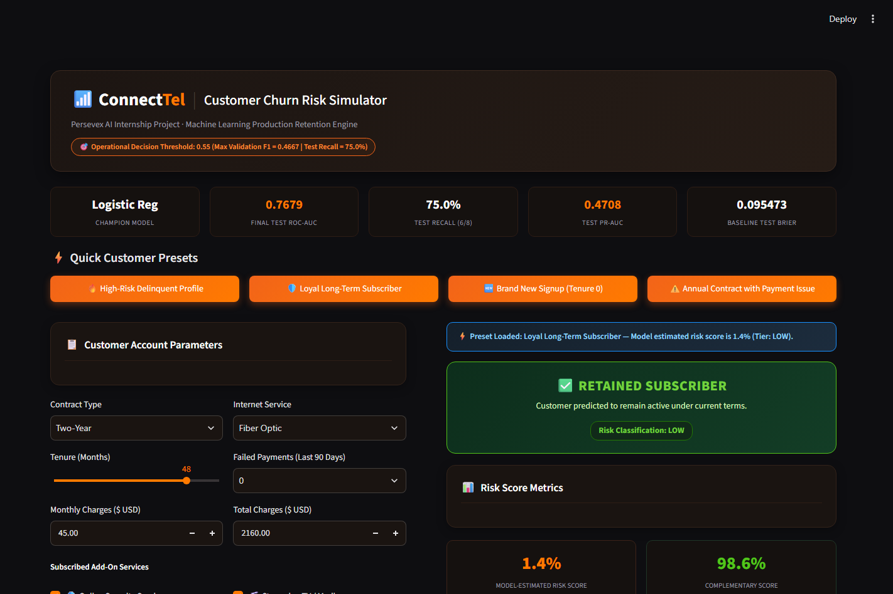

# ConnectTel – Predictive Customer Churn Model

An end-to-end machine learning classification, explainability, and interactive risk simulation system built for **ConnectTel Telecommunications** as part of the **Persevex AI Internship Project**.

This project predicts 30-day subscriber churn risk (`churn_30d`) on the official 320-record synthetic ConnectTel teaching dataset, explains key drivers using **SHAP (SHapley Additive exPlanations)** and parametric odds ratios, and operationalizes predictions through a modular inference engine and an interactive **Streamlit** simulator.

---

## 1. Project Overview & Problem Statement

Subscription-based telecommunications providers face recurring revenue erosion when customers cancel service unexpectedly. Waiting until a subscriber initiates cancellation leaves little opportunity for intervention.

ConnectTel's objective is to proactively flag subscribers exhibiting early churn risk signals—such as flexible month-to-month contracts, recent failed payments, and onboarding vulnerability—so retention specialists can prioritize timely, targeted retention outreach rather than relying on blanket discounts.

**Scope & Transparency Note:** All model training, statistical testing, and evaluation results in this repository are derived strictly from the official 320-record synthetic teaching dataset (`data/customers.csv`). Predicted scores (`predict_proba`) are uncalibrated discriminative risk scores produced with `class_weight='balanced'` to prioritize churn sensitivity rather than frequentist probability calibration.

---

## 2. Key Features

- **Zero-Leakage Modular Pipeline:** Stratified `train` / `validation` / `test` partitions with custom `TelecomFeatureEngineer` fitting, imputation, scaling, and encoding strictly inside training-only Scikit-Learn `Pipeline` objects.
- **Explicit Zero-Tenure Billing Logic:** Audits and resolves blank `total_charges_usd` values for `tenure_months == 0` subscribers (assigning `total_charges_usd = 0.0` and `total_charges_per_tenure = monthly_charges_usd`).
- **Multi-Model Benchmarking & Threshold Optimization:** Compares an Empirical Bayes `ContractGroupBaseline`, L2 Regularized Logistic Regression, Random Forest, and XGBoost using Stratified 5-Fold Cross-Validation and validation PR-AUC / F1 tuning (`0.55` operational decision cutoff).
- **Explainable AI (SHAP + Odds Ratios):** Combines global SHAP feature importance, beeswarm plots, local individual customer waterfall attributions, and Logistic Regression parametric odds ratios.
- **Interactive Churn Risk Simulator (`app.py`):** Local Streamlit web dashboard featuring Midnight Black × Electric Orange styling, four quick-load customer presets, real-time "What-If" manual parameter editing via `src/inference.py`, qualitative trigger detection, and a rule-linked retention playbook.

---

## 3. Technology Stack

| Category | Technologies & Libraries |
| :--- | :--- |
| **Language** | Python 3.13 (compatible with Python 3.10+) |
| **Machine Learning** | `scikit-learn` (>=1.5), `xgboost` (>=2.0), `scipy` (>=1.12), `joblib` (>=1.3) |
| **Data Processing** | `pandas` (>=2.2), `numpy` (>=1.25) |
| **Explainable AI** | `shap` (>=0.45) (`LinearExplainer` & `TreeExplainer`) |
| **Visualization** | `matplotlib` (>=3.8), `seaborn` (>=0.13) |
| **Web Interface** | `streamlit` (>=1.35) |
| **Notebooks & Docs** | Jupyter Notebooks (`.ipynb`), Markdown reports, PowerPoint (`ConnectTel_Executive_Presentation_Final.pptx`) |

---

## 4. System Architecture & Workflow

```text
data/customers.csv (N=320: 192 Train / 64 Validation / 64 Locked Test)
        │
        ▼
[Phase 1: EDA & Feature Engineering]  ──► notebooks/01_eda_and_feature_engineering.ipynb
        │   • Chi-Square hypothesis tests & exploratory diagnostics (outputs/eda_figures/)
        │   • TelecomFeatureEngineer (zero-tenure rule, service_count, charges_velocity_ratio, fiber_high_charge)
        ▼
[Phase 2: Model Training & Tuning]    ──► notebooks/02_model_training_and_tuning.ipynb
        │   • Stratified 5-Fold CV GridSearchCV (Logistic Regression, Random Forest, XGBoost)
        │   • Validation benchmarking & threshold tuning (0.55 cutoff) (outputs/model_eval_figures/)
        │   • Serialized champion pipeline ──► models/best_model_pipeline.joblib
        ▼
[Phase 3: Model Interpretation (XAI)] ──► notebooks/03_model_interpretation_and_business_recommendations.ipynb
        │   • Global SHAP, parametric Odds Ratios & local customer waterfalls (outputs/shap/)
        │   • Prescriptive 4-tier retention playbook (outputs/tables/business_action_playbook.csv)
        ▼
[Production Inference & Simulator UI] ──► src/inference.py + app.py (Local Streamlit App)
```

---

## 5. Dataset Information

Source file: [`data/customers.csv`](data/customers.csv) | Schema documentation: [`DATA_DICTIONARY.md`](DATA_DICTIONARY.md)

- **Records:** `320` synthetic customer snapshots (`C001`–`C320`, snapshot date `2025-01-01`).
- **Target Variable:** `churn_30d` (`1` = cancelled within 30 days, `0` = retained). Overall churn incidence is **16.9%** (`54` churned / `266` retained).
- **Predefined Stratified Partitions:**
  - **Train (`N = 192`):** 37 churned (`19.3%`), 155 retained (`80.7%`)
  - **Validation (`N = 64`):** 9 churned (`14.1%`), 55 retained (`85.9%`)
  - **Test (`N = 64`, held out until final evaluation):** 8 churned (`12.5%`), 56 retained (`87.5%`)
- **Input Features (8):** `tenure_months`, `contract`, `internet_service`, `monthly_charges_usd`, `total_charges_usd`, `security_service`, `streaming_service`, `failed_payments_90d`.
- **Leakage Controls:** `customer_id`, `snapshot_date`, `split`, and `churn_30d` are strictly excluded from feature matrices `X`.

---

## 6. EDA & Feature Engineering Summary

Key statistical findings on the training split (`N = 192`, see [`outputs/tables/hypothesis_tests.json`](outputs/tables/hypothesis_tests.json)):

- **Contract Type ($\chi^2 = 11.59, p = 0.0030$, Significant):** Month-to-month subscribers churn at **32.4%** (`22/68`) compared to **11.9%** (`7/59`) on annual contracts and **12.3%** (`8/65`) on two-year contracts.
- **Failed Payments in Past 90 Days ($\chi^2 = 7.17, p = 0.0277$, Significant):** Churn escalates monotonically from **8.6%** (`5/58` with 0 failures) to **19.6%** (`11/56` with 1 failure) and **26.9%** (`21/78` with 2 failures).
- **Internet Service ($\chi^2 = 4.04, p = 0.1327$, Not Individually Significant):** DSL shows **27.1%** churn (`16/59`), no internet **19.0%** (`11/58`), and fiber optic **13.3%** (`10/75`).
- **Engineered Features (`src/feature_engineering.py`):**
  - `is_zero_tenure`: Binary flag identifying newly onboarded zero-tenure accounts.
  - `total_charges_per_tenure`: Safe billing-velocity ratio applying the explicit zero-tenure rule.
  - `service_count`: Total subscribed add-ons (`security_service + streaming_service`).
  - `has_failed_payments`: Binary delinquency indicator (`failed_payments_90d > 0`).
  - `charges_velocity_ratio`: Ratio of cumulative monthly charge velocity to stated `monthly_charges_usd`.
  - `fiber_high_charge`: Interaction flag isolating fiber subscribers billed over `$70/month`.

---

## 7. Model Comparison & Champion Selection

All candidate pipelines were tuned on the training set (`N = 192`) via 5-fold Stratified Cross-Validation and evaluated on the validation set (`N = 64`, 9 churners) at cutoff `0.50` ([`outputs/tables/model_comparison_validation.csv`](outputs/tables/model_comparison_validation.csv)):

| Model | Key Tuned Hyperparameters | CV ROC-AUC | Val ROC-AUC | Val PR-AUC | Val Recall (0.50) | Val Precision (0.50) | Val F1 (0.50) | Val Brier Score |
| :--- | :--- | :---: | :---: | :---: | :---: | :---: | :---: | :---: |
| **ContractGroupBaseline** | Empirical Bayes prior smoothing | — | 0.6121 | 0.2289 | 0.00% | — | 0.0000 | **0.119013** |
| **Logistic Regression (Champion)** | `C=10.0`, `class_weight='balanced'` | **0.7141** | **0.7697** | **0.4923** | **77.78%** (`7/9`) | **31.82%** | **0.4516** | 0.204877 |
| **Random Forest** | `n_estimators=100`, `max_depth=5`, `min_samples_split=5`, `class_weight='balanced'` | 0.6570 | 0.7576 | 0.3191 | 66.67% (`6/9`) | 28.57% | 0.4000 | 0.173479 |
| **XGBoost Classifier** | `n_estimators=30`, `max_depth=3`, `learning_rate=0.15`, `scale_pos_weight=4.19` | 0.7001 | 0.7020 | 0.3413 | 55.56% (`5/9`) | 25.00% | 0.3448 | 0.175568 |

**Why Logistic Regression Won:** It achieved the highest Validation ROC-AUC (`0.7697`) and more than doubled baseline PR-AUC (`0.4923` vs `0.2289`), resisting small-sample overfitting while providing direct parametric odds ratios.

---

## 8. Verified Model Evaluation Metrics & Operational Thresholding

### Operational Decision Threshold Selection (`0.55`)
From [`outputs/tables/threshold_analysis.csv`](outputs/tables/threshold_analysis.csv), shifting the champion cutoff from `0.50` to **`0.55`** on Validation (`N = 64`) reduced false alarms from `15` to `14` without losing a caught churner:
- At `0.50`: Precision `31.82%`, Recall `77.78%` (`7/9`), F1 `0.4516` (`TP=7, FP=15, FN=2, TN=40`)
- At `0.55`: Precision `33.33%`, Recall `77.78%` (`7/9`), **Peak Validation F1 `0.4667`** (`TP=7, FP=14, FN=2, TN=41`)

### Final Locked Test Set Evaluation (`N = 64`, 8 Churners)
Evaluated strictly once without retraining or tuning ([`outputs/tables/final_test_evaluation.csv`](outputs/tables/final_test_evaluation.csv)):

| Evaluation Target | ROC-AUC | PR-AUC | Recall | Precision | F1-Score | Brier Score | Confusion Matrix (`TP / FP / FN / TN`) |
| :--- | :---: | :---: | :---: | :---: | :---: | :---: | :--- |
| **Historical Contract Baseline** | 0.6127 | 0.1764 | 0.00% (`0/8`) | 0.00% | 0.0000 | **0.095473** | `0 / 0 / 8 / 56` |
| **Champion LR (Cutoff `0.50`)** | **0.7679** | **0.4708** | **75.00%** (`6/8`) | 24.00% | 0.3636 | 0.209454 | `6 / 19 / 2 / 37` |
| **Champion LR (Cutoff `0.55`)** | **0.7679** | **0.4708** | **75.00%** (`6/8`) | **25.00%** | **0.3750** | 0.209454 | `6 / 18 / 2 / 38` |

---

## 9. SHAP Explainability & Key Business Levers

Global and local model attributions from [`outputs/tables/feature_importance_champion.csv`](outputs/tables/feature_importance_champion.csv):

| Feature | Champion Coefficient | Odds Ratio ($\exp(\beta)$) | Mean \|SHAP\| | Effect Direction |
| :--- | :---: | :---: | :---: | :--- |
| `contract_monthly` | `+1.9512` | **7.04x** | **0.8778** | Risk Factor (Increases Churn) |
| `internet_service_fiber` | `-1.7357` | **0.18x** | **0.7967** | Protective (Cohort Anchor) |
| `tenure_months` | `-0.8108` | **0.44x** | **0.7356** | Protective (Tenure Stability) |
| `failed_payments_90d` | `+0.5615` | **1.75x** | **0.5200** | Risk Factor (Payment Distress) |
| `has_failed_payments` | `+0.7585` | **2.14x** | **0.3558** | Risk Factor (Delinquency Flag) |
| `fiber_high_charge` | `+0.4564` | **1.58x** | **0.1154** | Risk Factor (Premium Price Friction) |
| `security_service` | `-0.2353` | **0.79x** | **0.1158** | Protective (Product Stickiness) |

Verified validation-set local SHAP case plots in `outputs/shap/`:
- **Customer `#C225` (Model score `85.8%`, actual churned):** Driven by monthly contract and failed payment delinquency.
- **Customer `#C193` (Model score `8.7%`, actual retained):** Protected by fiber baseline, zero payment failures, and multi-month contract lock-in.
- **Customer `#C210` (Model score `95.1%`, actual retained):** Preventive intervention illustration showcasing sensitivity to short tenure + payment issues.

---

## 10. Streamlit Application Features

Built in [`app.py`](app.py) atop [`src/inference.py`](src/inference.py):

- **Authenticated Champion Pipeline Inference:** Calls `predict_churn()` using `models/best_model_pipeline.joblib` at operational decision threshold `0.55` with zero mocked outputs.
- **Four Quick Customer Presets:** One-click profile testing (*High-Risk Delinquent Profile*: `90.96%` Critical, *Loyal Long-Term Subscriber*: `1.42%` Low, *Brand New Signup (Tenure 0)*: `19.43%` Low, *Annual Contract with Payment Issue*: `34.53%` Medium).
- **Manual What-If Simulator & State Tracking:** Adjust any of the 8 customer parameters and click **Calculate Churn Risk** to re-score the account, inspect the risk classification tier (`Critical`, `High`, `Medium`, `Low`), view active risk triggers, and review tailored retention recommendations.
- **Transparent Scoring Labels:** Displays outputs explicitly as **Model-Estimated Risk Score (Uncalibrated discriminative score)** and **Complementary Score**.

---

## 11. Installation & Local Execution

*(Note: Run locally on Python 3.10+; the application is verified for local execution and has not yet been deployed to cloud hosting.)*

1. **Clone the repository and navigate to the folder:**
   ```bash
   git clone https://github.com/misbba/ConnectTel-Predictive-Customer-Churn.git
   cd ConnectTel-Predictive-Customer-Churn
   ```
2. **Install dependencies:**
   ```bash
   python -m pip install -r requirements.txt
   ```
3. **Run the Streamlit Churn Risk Simulator locally:**
   ```bash
   python -m streamlit run app.py
   ```
   Open `http://localhost:8501` in your browser.
4. **Verify baseline or inference scripts locally (optional):**
   ```bash
   python baseline.py
   python src/inference.py
   ```

---

## 12. Project Folder Structure

```text
ConnectTel-Predictive-Customer-Churn/
├── .streamlit/
│   └── config.toml                 # Midnight Black x Electric Orange Streamlit theme
├── data/
│   └── customers.csv               # Official 320-record synthetic teaching dataset
├── deliverables/
│   └── ConnectTel_Executive_Presentation_Final.pptx  # Final 16-slide presentation
├── models/
│   ├── best_model_pipeline.joblib  # Champion L2 Logistic Regression pipeline
│   ├── logistic_regression_pipeline.joblib
│   ├── random_forest_pipeline.joblib
│   └── xgboost_pipeline.joblib
├── notebooks/
│   ├── 01_eda_and_feature_engineering.ipynb
│   ├── 02_model_training_and_tuning.ipynb
│   └── 03_model_interpretation_and_business_recommendations.ipynb
├── outputs/
│   ├── app_screenshots/            # Captured Streamlit UI screenshots
│   ├── eda_figures/                # 7 Exploratory Data Analysis charts
│   ├── model_eval_figures/         # 6 ROC, PR, Confusion Matrix & Threshold plots
│   ├── shap/                       # 7 Global & local SHAP explainability figures
│   ├── tables/                     # 8 Ground-truth CSV/JSON evaluation tables
│   ├── baseline_evaluation_full.json
│   ├── baseline_metrics.json
│   └── baseline_predictions.csv
├── reports/                        # Technical audit, XAI & phase completion reports
├── scripts/                        # Execution, screenshot & verification utilities
├── src/
│   ├── data_loader.py
│   ├── eda.py
│   ├── feature_engineering.py
│   ├── inference.py
│   ├── interpretability.py
│   └── models.py
├── app.py                          # Main Streamlit web application
├── baseline.py                     # Empirical Bayes contract-group baseline
├── DATA_DICTIONARY.md              # Dataset schema reference
├── requirements.txt                # Project Python dependencies
└── README.md                       # Project overview & documentation
```

---

## 13. Application Screenshots

### High-Risk Subscriber Assessment (`91.0%` Risk Score — Critical)


### Loyal Long-Term Subscriber Preset (`1.4%` Risk Score — Low)


---

## 14. Final Presentation Reference

The finalized 16-slide executive presentation summarizing ConnectTel's data audit, EDA findings, model comparison, validation/test generalization, SHAP insights, working Streamlit simulator, and business retention recommendations is stored at:

- [`deliverables/ConnectTel_Executive_Presentation_Final.pptx`](deliverables/ConnectTel_Executive_Presentation_Final.pptx)
