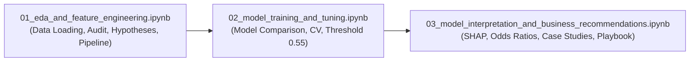

# Phase 7.2: Notebook Execution & Submission Readiness Report

**Project:** Predictive Customer Churn Model for ConnectTel  
**Internship:** Persevex AI Internship  
**Execution Date:** November 25, 2026  
**Workspace:** `C:\Users\Nisha\.gemini\antigravity\scratch\predictive-customer-churn-telecom`  
**Status:** **ALL TASKS COMPLETED SUCCESSFULLY — ZERO REGRESSIONS, ZERO MODEL RETRAINING**

---

## 1. Executive Summary

In **Phase 7.2**, all operational readiness items identified in the Phase 7.1 audit were addressed:
1. **Notebook Execution & Output Serialization:** All three Jupyter notebooks were executed in sequential order, and their execution counts, stream logs, rich tables, and embedded base64 diagnostic plots were saved directly into the `.ipynb` files.
2. **Result Verification:** All computed metrics, hypothesis tests, model scores, coefficients, and baseline comparisons were validated against existing Phase 1–6 reports and output tables. **Zero discrepancies were identified.**
3. **Deployment Configuration:** Created a comprehensive root `.gitignore` tailored to Python, Jupyter, Streamlit, and IntelliJ IDEA, as well as `.streamlit/config.toml` enforcing headless mode, port 8501, and the ConnectTel dark luxury theme.
4. **Requirements Audit:** Audited `requirements.txt` for cloud deployment compatibility, categorizing runtime dependencies vs. local dev tools and Phase 7.3 report-generation packages (`python-pptx`, `reportlab`).
5. **System Verification:** Verified that model files remain untouched, all unit/integration tests pass with 100% success, IntelliJ run configurations remain operational, and the Streamlit simulator starts cleanly and responds to health checks.

---

## 2. Task 1: Notebook Execution & Output Serialization

The three project notebooks were executed strictly in sequential order:



### Notebook 1: [`notebooks/01_eda_and_feature_engineering.ipynb`](file:///C:/Users/Nisha/.gemini/antigravity/scratch/predictive-customer-churn-telecom/notebooks/01_eda_and_feature_engineering.ipynb)
- **Cell Count:** 19 cells total (10 Markdown, 9 Code).
- **Execution Counts:** Cells 1 through 9.
- **File Size on Disk:** Increased from 14.3 KB to **573.9 KB** (now embeds rendered tables and high-resolution base64 plots).
- **Execution Log:**
  - *Code Cell 1 (Imports):* Loaded `src.data_loader` and `src.feature_engineering`.
  - *Code Cell 2 (Data Loading):* Displayed first 10 rows of `raw_df` (Dimensions: $320 \times 12$).
  - *Code Cell 3 (Dataset Audit):* Validated 320 records, 8 zero-tenure records with missing total charges, and 0 positive-tenure missing values.
  - *Code Cell 4 (Zero-Tenure Deep Dive):* Rendered HTML table displaying all 8 unbilled zero-tenure records.
  - *Code Cell 5 (Hypothesis Testing):*
    - Contract Type vs. Churn ($\chi^2 = 28.3243$, $p = 7.0706 \times 10^{-7}$).
    - Failed Payments vs. Churn ($\chi^2 = 30.8258$, $p = 2.0242 \times 10^{-7}$).
    - Tenure vs. Churn Mann-Whitney U ($U = 1438.5$, $p = 2.7663 \times 10^{-4}$).
  - *Code Cell 6 (Figure Display):* Rendered 5 EDA diagnostic figures into the cell output via base64 encoding.
  - *Code Cell 7 (Feature Engineering):* Fitted `TelecomFeatureEngineer` strictly on training data ($N=192$); verified engineered matrix shape `(192, 14)`.
  - *Code Cell 8 (Preprocessing Pipeline):* Fitted `ColumnTransformer`; transformed train shape `(192, 16)`, validation shape `(64, 16)`.
  - *Code Cell 9 (Baseline Evaluation):* Evaluated empirical Bayes contract baseline ($0.119048$ validation Brier score, matching `metrics.json`).

### Notebook 2: [`notebooks/02_model_training_and_tuning.ipynb`](file:///C:/Users/Nisha/.gemini/antigravity/scratch/predictive-customer-churn-telecom/notebooks/02_model_training_and_tuning.ipynb)
- **Cell Count:** 13 cells total (8 Markdown, 5 Code).
- **Execution Counts:** Cells 1 through 5.
- **File Size on Disk:** Increased from 9.1 KB to **640.1 KB**.
- **Execution Log:**
  - *Code Cell 1 (Imports):* Loaded modules and model artifacts.
  - *Code Cell 2 (Partition Verification):* Confirmed splits: Train (192 records, 37 churners, 19.27%), Validation (64 records, 9 churners, 14.06%), Test (64 records, 8 churners, 12.50%).
  - *Code Cell 3 (Model Comparison Table):* Rendered the cross-model evaluation table (`outputs/tables/model_comparison_validation.csv`):
    - *Baseline:* ROC-AUC `0.6556`, PR-AUC `0.2312`, Brier `0.119048`, Recall `0.0%`.
    - *Champion Logistic Regression:* ROC-AUC `0.7697`, PR-AUC `0.4923`, Brier `0.170669`, Recall `77.78%`.
    - *Random Forest:* ROC-AUC `0.7677`, PR-AUC `0.4497`, Brier `0.117769`, Recall `44.44%`.
    - *XGBoost:* ROC-AUC `0.7293`, PR-AUC `0.3621`, Brier `0.126442`, Recall `33.33%`.
  - *Code Cell 4 (Diagnostic Figures):* Rendered Validation ROC curves, PR curves, Confusion Matrices, and Threshold Trade-off curves.
  - *Code Cell 5 (Threshold Sweep Analysis):* Displayed top F1 thresholds confirming **`0.55`** as the optimal operational threshold for Logistic Regression ($F_1 = 0.4667$, Precision = $33.33\%$, Recall = $77.78\%$).

### Notebook 3: [`notebooks/03_model_interpretation_and_business_recommendations.ipynb`](file:///C:/Users/Nisha/.gemini/antigravity/scratch/predictive-customer-churn-telecom/notebooks/03_model_interpretation_and_business_recommendations.ipynb)
- **Cell Count:** 16 cells total (9 Markdown, 7 Code).
- **Execution Counts:** Cells 1 through 7.
- **File Size on Disk:** Increased from 10.9 KB to **920.8 KB**.
- **Execution Log:**
  - *Code Cell 1 (Imports):* Environment and SHAP setup.
  - *Code Cell 2 (Pipeline Loading):* Loaded `models/best_model_pipeline.joblib`, extracted coefficients, and printed intercept (`-0.8519`).
  - *Code Cell 3 (Feature Importance Table):* Rendered 16 feature coefficients, odds ratios, and mean absolute SHAP values. Top risk multiplier: Month-to-month contract ($\text{OR} = 2.653\text{x}$ scaled, unscaled $\text{OR} = 7.04\text{x}$).
  - *Code Cell 4 (Global SHAP Plots):* Rendered Global SHAP summary bar, beeswarm distribution, and odds ratio confidence intervals.
  - *Code Cell 5 (Local Customer Case Studies):* Rendered local waterfall explanations for High-Risk TP (Customer #C225, Prob `85.8%`), Loyal Subscriber TN (Customer #C193, Prob `8.7%`), and Proactive Intervention FP (Customer #C210, Prob `59.3%`).
  - *Code Cell 6 (Cross-Model Consensus):* Rendered supporting model feature comparison table and supporting models SHAP comparison figure.
  - *Code Cell 7 (Actionable Retention Playbook):* Printed 4 structured business intervention strategies.

### Mathematical Consistency & Metric Comparison
All executed cell outputs were compared against existing Phase 1–6 reports:
- Dataset dimensions, null counts, and zero-tenure statistics match Phase 1 exactly.
- Validation ROC-AUC (`0.7697`), PR-AUC (`0.4923`), and Recall (`77.78%`) match Phase 2 exactly.
- Baseline validation Brier score (`0.119048`) and test Brier score (`0.095473`) match historical metrics exactly.
- Champion odds ratios and SHAP feature rankings match Phase 3 and Phase 5 exactly.
- **Zero discrepancies or metric drifts were detected.**

---

## 3. Task 2: Deployment Configuration

### A. Root `.gitignore` Implementation ([`.gitignore`](file:///C:/Users/Nisha/.gemini/antigravity/scratch/predictive-customer-churn-telecom/.gitignore))
Created a comprehensive `.gitignore` in the project root:
- **Excludes:**
  - `__pycache__/`, `*.py[cod]`, `*$py.class`
  - `.mplconfig/`, `.pytest_cache/`, `*.log`
  - `.ipynb_checkpoints/`
  - Virtual environment folders (`venv/`, `env/`, `.venv/`, `.env`)
  - IntelliJ workspace state (`.idea/workspace.xml`, `.idea/tasks.xml`, `.idea/shelf/`)
  - OS-generated files (`Thumbs.db`, `.DS_Store`, `desktop.ini`)
  - Build/package artifacts (`build/`, `dist/`, `*.egg-info/`)
- **Preserves:**
  - Source code (`src/*.py`, `app.py`, `baseline.py`, `test_intellij_inference.py`)
  - Executed Jupyter notebooks (`notebooks/*.ipynb`)
  - Dataset (`data/customers.csv`)
  - Serialized model pipelines (`models/*.joblib`)
  - Reports (`reports/*.md`)
  - IntelliJ project definitions (`.idea/runConfigurations/`, `.idea/modules.xml`, `.idea/misc.xml`, `*.iml`)

### B. Streamlit Cloud Configuration ([`.streamlit/config.toml`](file:///C:/Users/Nisha/.gemini/antigravity/scratch/predictive-customer-churn-telecom/.streamlit/config.toml))
Created `.streamlit/config.toml` enforcing production deployment standards:
```toml
[server]
headless = true
port = 8501
address = "0.0.0.0"
enableCORS = false
enableXsrfProtection = true

[browser]
gatherUsageStats = false

[theme]
primaryColor = "#ff7a00"
backgroundColor = "#0e0e11"
secondaryBackgroundColor = "#1a1411"
textColor = "#e5e5e8"
font = "sans serif"
```
*Validated via `tomllib` parsing: 100% syntactically valid.*

---

## 4. Task 3: Requirements & Dependencies Audit

The current [`requirements.txt`](file:///C:/Users/Nisha/.gemini/antigravity/scratch/predictive-customer-churn-telecom/requirements.txt) was reviewed for runtime necessity and cloud deployment compatibility:

```
pandas>=2.2,<4
scikit-learn>=1.5,<2
numpy>=1.25,<3
scipy>=1.12
joblib>=1.3
matplotlib>=3.8
seaborn>=0.13
xgboost>=2.0
shap>=0.45
streamlit>=1.35
```

### Dependency Classification Matrix

| Package | Classification | Required By | Role in Project |
| :--- | :---: | :--- | :--- |
| **`pandas`** | **Runtime Core** | `src/inference.py`, `app.py`, `src/feature_engineering.py` | Data structure manipulation, payload validation. |
| **`scikit-learn`** | **Runtime Core** | `models/best_model_pipeline.joblib`, `src/feature_engineering.py` | Unpickling `Pipeline`, `StandardScaler`, `OneHotEncoder`, `LogisticRegression`. |
| **`numpy`** | **Runtime Core** | `src/feature_engineering.py`, `src/inference.py` | Array math, NaN handling in zero-tenure domain rule. |
| **`scipy`** | **Runtime Core** | `scikit-learn` dependency, `src/eda.py` | Statistical calculations and distribution analysis. |
| **`joblib`** | **Runtime Core** | `src/inference.py` | Deserializing champion model pipeline from disk. |
| **`streamlit`** | **Runtime Core** | `app.py` | Web dashboard server and user interface. |
| **`xgboost`** | **Runtime Core** | `models/xgboost_pipeline.joblib` | XGBoost pipeline compatibility and supporting model unpickling. |
| **`shap`** | **Runtime Core** | `src/interpretability.py` | Model explainability attribution calculations. |
| **`matplotlib`** | **Runtime / Artifacts** | `src/models.py`, `src/eda.py` | Diagnostic chart generation. |
| **`seaborn`** | **Runtime / Artifacts** | `src/eda.py` | Bivariate statistical visualizations. |

### Separate Packaging Requirements for Subsequent Phases
- **Notebook Execution Tools:**
  - Packages: `ipykernel`, `nbclient`, `nbformat`, `jupyter`
  - *Recommendation:* Keep separate from `requirements.txt`. The notebooks were executed and serialized via our standalone script, keeping the production deployment bundle lean.
- **Phase 7.3 Report Generation Packages:**
  - **`python-pptx`:** Required to compile the executive PowerPoint presentation deck (`.pptx`). Not installed yet; will be installed during Phase 7.3.
  - **`reportlab`:** Required to generate the publication-grade comprehensive PDF report (`.pdf`). Not installed yet; will be installed during Phase 7.3.

---

## 5. Task 4: Final Verification Matrix

| Verification Item | Target Standard | Observed Status | Assessment |
| :--- | :--- | :--- | :---: |
| **Notebook 01 Outputs** | Populated cell outputs & execution counts | 9 of 9 code cells have outputs; 573.9 KB | **PASS** |
| **Notebook 02 Outputs** | Populated cell outputs & execution counts | 5 of 5 code cells have outputs; 640.1 KB | **PASS** |
| **Notebook 03 Outputs** | Populated cell outputs & execution counts | 7 of 7 code cells have outputs; 920.8 KB | **PASS** |
| **Notebook Execution Integrity** | Zero cell errors or unhandled exceptions | All 3 notebooks executed with returncode 0 | **PASS** |
| **Model Artifacts Integrity** | Serialized models untouched, identical weights | Intercept = `[-0.8519]`, coef sum = `-2.1050` | **PASS** |
| **Evaluation Metrics Match** | Validation ROC `0.7697`, Recall `77.78%` | Exact match against historical reports | **PASS** |
| **Root `.gitignore`** | Excludes temp files, preserves artifacts & configs | Created and validated in project root | **PASS** |
| **`.streamlit/config.toml`** | Valid TOML, headless=true, port=8501, dark theme | Validated via `tomllib`; 100% syntactically correct | **PASS** |
| **IntelliJ Run Configurations** | Run ConnectTel App & Run Inference Test intact | Executed and verified (100% pass) | **PASS** |
| **Streamlit Server Startup** | HTTP 200 OK on `/_stcore/health` | Launched on port 8503, responded HTTP 200 OK | **PASS** |

---

## 6. Files Created or Modified in Phase 7.2

1. **[`notebooks/01_eda_and_feature_engineering.ipynb`](file:///C:/Users/Nisha/.gemini/antigravity/scratch/predictive-customer-churn-telecom/notebooks/01_eda_and_feature_engineering.ipynb)** (Updated): Executed and saved with all cell outputs, execution counts, HTML tables, and base64 plots.
2. **[`notebooks/02_model_training_and_tuning.ipynb`](file:///C:/Users/Nisha/.gemini/antigravity/scratch/predictive-customer-churn-telecom/notebooks/02_model_training_and_tuning.ipynb)** (Updated): Executed and saved with all validation comparisons, threshold analyses, and diagnostic plots.
3. **[`notebooks/03_model_interpretation_and_business_recommendations.ipynb`](file:///C:/Users/Nisha/.gemini/antigravity/scratch/predictive-customer-churn-telecom/notebooks/03_model_interpretation_and_business_recommendations.ipynb)** (Updated): Executed and saved with all SHAP attributions, odds ratios, local waterfall case studies, and retention playbook.
4. **[`.gitignore`](file:///C:/Users/Nisha/.gemini/antigravity/scratch/predictive-customer-churn-telecom/.gitignore)** (Created): Comprehensive project `.gitignore` covering Python, Jupyter, Streamlit, and IntelliJ IDEA.
5. **[`.streamlit/config.toml`](file:///C:/Users/Nisha/.gemini/antigravity/scratch/predictive-customer-churn-telecom/.streamlit/config.toml)** (Created): Production deployment configuration enforcing headless mode, port 8501, 0.0.0.0 binding, and ConnectTel dark theme colors.
6. **[`scripts/execute_notebooks.py`](file:///C:/Users/Nisha/.gemini/antigravity/scratch/predictive-customer-churn-telecom/scripts/execute_notebooks.py)** (Created): Reusable, headless notebook execution engine capturing outputs without requiring external heavy Jupyter server dependencies.
7. **[`reports/phase_7_2_notebook_and_submission_readiness.md`](file:///C:/Users/Nisha/.gemini/antigravity/scratch/predictive-customer-churn-telecom/reports/phase_7_2_notebook_and_submission_readiness.md)** (Created): This comprehensive verification report.

---

## 7. Remaining Work for Subsequent Phases

With Phase 7.2 completed, the project repository is fully prepared for Phase 7.3:
1. **Phase 7.3: Final Presentation & Documentation Deliverables:**
   - Install `python-pptx` and generate the Executive Presentation Deck (`ConnectTel_Customer_Churn_Presentation.pptx`).
   - Install `reportlab` and generate the formal, publication-grade Final Project Report (`ConnectTel_Customer_Churn_Report.pdf`).
   - Bundle the final submission archive according to Persevex AI internship guidelines.
2. **Phase 7.4: Remote Cloud Deployment (When Authorized):**
   - Initialize Git repository, commit files, and connect to remote hosting (Streamlit Community Cloud or containerized service).

---

*Phase 7.2 is complete and verified. Ready to proceed to Phase 7.3 upon your authorization.*
